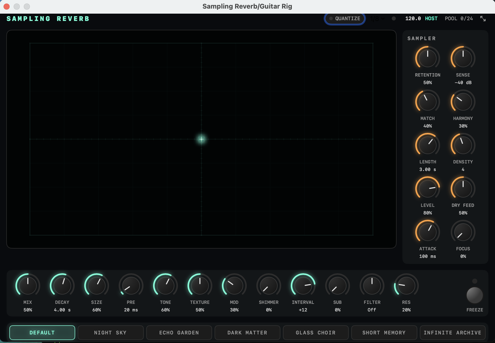

# Sampling Reverb



A macOS Audio Unit (AUv3) reverb that samples what you play and replays matching phrases into a
shimmering, NightSky-style reverb. It runs standalone or as an effect in Ableton Live.
See [docs/design.md](docs/design.md) for how it works.

## Requirements

- macOS 13+ and Xcode 26+
- `brew install xcodegen`
- `xcodebuild -downloadComponent MetalToolchain` (one-time; Xcode's Metal shader compiler)

## Build and run

```sh
make install    # builds, copies to /Applications, registers the AU and launches the app
make validate   # runs Apple's auval against the plugin
make test       # C++ DSP tests + Swift tests
```

The standalone app starts with the source **Off**. Pick your input and output devices, then choose
**Input** (use headphones, or speakers away from the mic) or **File** and play.

## Ableton Live

1. Run `make install`. Quit Live first: replacing the app disconnects a plugin that's in use.
2. In Live, go to **Settings → Plug-Ins** and turn on **Use Audio Units v3**. This is a separate
   switch from "Use Audio Units v2", and this plugin needs v3. Then rescan.
3. Add **Plug-Ins → Audio Units → Craig McNamara → Sampling Reverb** to an audio track.

## License

MIT. See [LICENSE](LICENSE).
